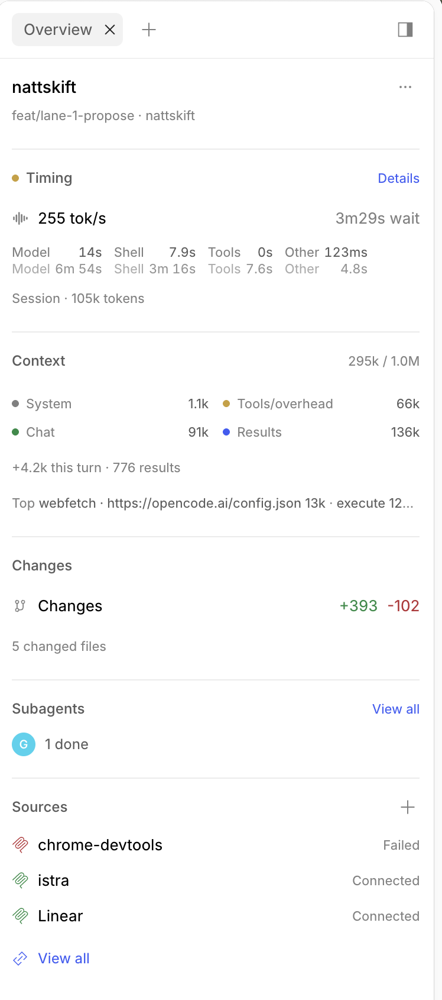

# opencode-session-overview

[](https://github.com/olasundell/opencode-session-overview/actions/workflows/ci.yml)
[](LICENSE)

A Codex-style session overview for OpenCode Desktop, as a native side panel
instead of a composer pill.



## Features

| Section | What it shows |
| --- | --- |
| **Project** | Project name, current branch, and directory |
| **Actions** | Copy the session ID or directory, open a terminal, or start a new session |
| **Timing** | Session throughput and wait time, with current/last-run and cumulative breakdowns |
| **Context** | Context-window composition, largest consumers, and this turn's growth |
| **Changes** | Working-tree additions and deletions, with a per-file list |
| **Subagents** | Child sessions with running/done counts and click-through |
| **Sources** | MCP servers, web search, integrations, and references |

The panel is a normal side-panel tab. It opens automatically the first time a
primary session becomes active in a window. If you close it, it stays closed for
that session until the window reloads. You can also open it from the **+** menu
under **Overview**, or run `/overview`. It can be dragged to the bottom pane
like any other panel tab.

### Timing details

A status dot next to Timing is green while the session is running and orange
while waiting for input. **Details** opens the full list, including time waiting
on you and provider retries, plus a **Show all turns** switch.

Timing follows the measurement rules from `opencode-turn-meter`: provider-active
time is `created → streamed`, tool time is the union of tool intervals, and wait
time is turn wall clock minus model request time. Cumulative figures sum the
individual turns, so idle gaps between turns are excluded. The panel reads the
current state every two seconds.

Live permission, form, and retry waits are tracked at plugin level, so closing
and reopening the panel keeps them. Reloading the app loses waits that only
existed as live events; completed turns fall back to persisted messages.

## Requirements

- OpenCode Desktop `>=2.2.6 <3`
- Node.js and pnpm to build from source

## Install

### From a release

Download the release and extract it into a stable directory:

```sh
mkdir -p ~/.local/share/opencode/plugins/opencode-session-overview
curl -fL https://github.com/olasundell/opencode-session-overview/releases/download/v0.1.0/opencode-session-overview-0.1.0.tgz \
  | tar -xz --strip-components=1 -C ~/.local/share/opencode/plugins/opencode-session-overview
```

Then register that directory in your global desktop config:

```jsonc
// ~/.config/opencode/opencode.jsonc
{
  "$schema": "https://opencode.ai/config.json",
  "plugins": [
    {
      "package": "file:///Users/you/.local/share/opencode/plugins/opencode-session-overview"
    }
  ]
}
```

Replace `/Users/you` with your home directory; on Linux the path is usually
`/home/you/.local/share/opencode/plugins/opencode-session-overview`. The release
includes the built `dist/gui-experimental.cjs`, so no build step is needed.

OpenCode applies config changes automatically. **Settings > Extensions >
Plugins** lists the plugin once it loads.

### From source

Clone the repository and build the GUI bundle:

```sh
git clone https://github.com/olasundell/opencode-session-overview.git
cd opencode-session-overview
pnpm install
pnpm build
```

Then add the clone's absolute path to your global desktop config:

```jsonc
// ~/.config/opencode/opencode.jsonc
{
  "$schema": "https://opencode.ai/config.json",
  "plugins": [
    {
      "package": "file:///absolute/path/to/opencode-session-overview"
    }
  ]
}
```

OpenCode Desktop reads `opencode.json(c)`; TUI-only entries in `cli.json` do not
load here. Rebuilding `dist/gui-experimental.cjs` reloads the GUI in every
window.

## Options

| Option | Default | Description |
| --- | --- | --- |
| `autoOpen` | `true` | Open the Overview panel on the first active visit to each primary session in a window |

```jsonc
{
  "plugins": [
    {
      "package": "file:///absolute/path/to/opencode-session-overview",
      "options": {
        "autoOpen": true
      }
    }
  ]
}
```

## Development

```sh
pnpm check   # typecheck, Oxlint, unit tests, GUI bundle
pnpm lint    # Oxlint, warnings treated as failures
```

CI runs the same gate on every push and pull request.

The GUI is experimental. It uses only supported Desktop surfaces
(`session.header`, `session.location.menu`, `session.panel.end`, `window.bottom`,
side panels, and dialogs); a floating top-right card is out of scope.

## License

MIT © 2026 Ola Sundell
